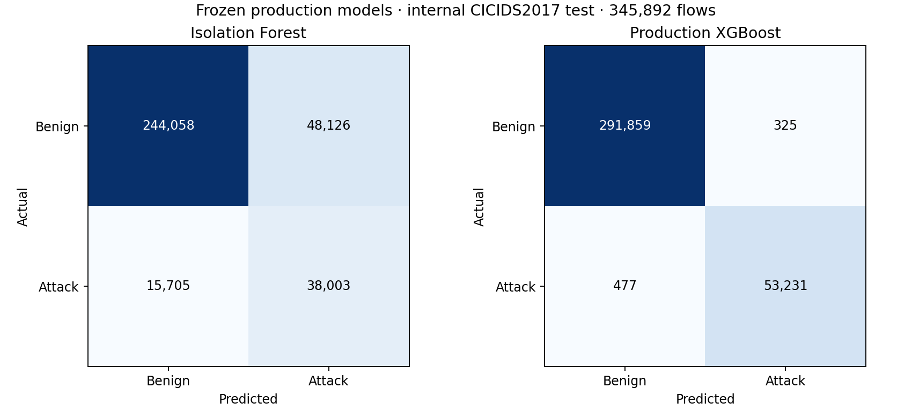
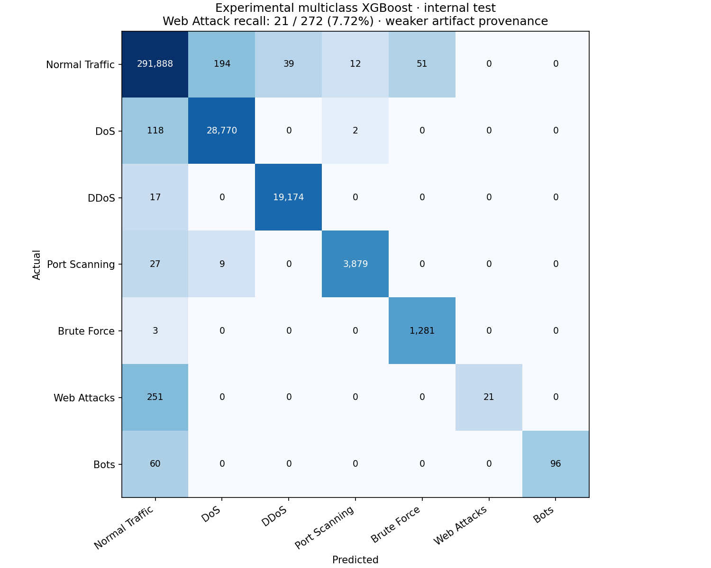

# Issue 3 — executed network reliability review

Completed locally on 2026-10-30. Frozen inference only; no model/scaler training, threshold retuning, full-dataset download, or external-dataset validation was performed.

## Implementation and checkpoint

Issue 2 was reviewed and checkpointed as `10bd89dd62037b21901fb2612c99e0520a4af359` on `codex/issue-2-pe-malware-ml`. Issue 1 checkpoint `4701b7d99fb3d22168031312353686e2a15f7a28` remains in history. Work continued on `codex/issue-3-network-ml`. The existing untracked `dfr-01-ntfs.dd/` evidence directory was not changed or staged. Model binaries, source CSVs, scratch databases, credentials and .env files are excluded from source commits.

Changes:

- `scripts/benchmark_supervised.py`: baseline inference now receives raw held-out features and applies its own scaler exactly once. Raw test/validation frames are retained alongside candidate-scaled arrays. Training requires an explicit flag and refuses overwriting historical results.
- `ml/supervised_detector.py`: validate estimator type, fitted feature dimensions/order, microsecond units, runtime versions, label semantics, threshold and uncalibrated score contract. Both network loaders fingerprint the exact bytes loaded.
- `ml/risk_scorer.py`: supervised attack scores increase triage severity directly; they are no longer inverted as anomaly margins. Existing 60/40 empirical network ML/rule weighting remains, documented separately from confidence. Rule-only host and PE/YARA scoring is preserved.
- `backend/app.py`, `backend/config.py`: explicit selector/default, accurate inventory, no fallback, per-flow model ID/score/threshold, measured counters/timings, selected evaluation endpoint and exact original numeric-feature persistence. MongoDB metadata normalizes label-map keys to BSON-compatible strings.
- `backend/integration.py`, `backend/report_generator.py`: preserve selected detector in artifacts, case-source summaries, rationale and saved-case PDFs.
- React `IntakePanel`, `IntakeHistory`, `CaseArtifacts`: availability-aware selector, selection/provenance, actual decisions and separate prediction/score/threshold/risk.
- Nine new network regression cases plus frozen evaluation, threshold replay, overlap diagnosis, real HTTP demonstration and artifact-acquisition scripts. CI uses pinned released weights and never trains them.

## Deployed artifacts and preprocessing

| Artifact / actual estimator | ID | Threshold | Bytes | SHA-256 |
|---|---|---:|---:|---|
| cicids2017_baseline.joblib / IsolationForest | iforest-65dd0b57a2b1a2020a0b | 0.0 | 760117 | `8602d9e6f57d347a10ebbca7290ad2bc75892f9c7f8b29dcc97c2fea20035c0d` |
| supervised_binary.joblib / XGBClassifier | xgb-bin-12ad91fa39 | 0.4343418846451664 | 1299382 | `ee4bc46fee3d1957bd080246c84bf6dedee246b25d29c1ecd6dfaf63d2100e3f` |

The two original fitted bundles are published as [network-models-v1](https://github.com/U-m-4r/cyber-triage-tool/releases/tag/network-models-v1), outside Git source history. A fresh public download, checksum verification, model load and 84-row inference passed (`release-download.txt`, `release-verification.json`, `release-assets.json`). Joblib is executable serialization; the downloader accepts only the reviewed checksum-pinned project assets. No recovered/uploaded model is loaded.

Feature schema v1: `Flow Duration`, `Total Fwd Packets`, `Total Length of Fwd Packets`, `Fwd Packet Length Max`, `Fwd Packet Length Min`, `Fwd Packet Length Mean`, `Bwd Packet Length Max`, `Bwd Packet Length Min`, `Flow Bytes/s`, `Flow Packets/s`, `Packet Length Mean`. Raw float64 inputs, exact order; duration microseconds, packet lengths/totals bytes, counts packets, rates per second. Each bundle applies its own saved StandardScaler once. Tree implementations reduce model inputs to float32, audited below.

Isolation Forest: 100 trees, seed 42, contamination 0.1; fitted only on 1,051,117 unique benign training vectors. Decision function <0 is anomaly (score_samples offset -0.47321778481357596). XGBoost: 200 trees, max_depth 8, learning_rate 0.08, histogram method, seed 42; scaler fit on all 1,612,277 training rows, labels 0=BENIGN and 1=ATTACK. Exact saved metadata, versions, training provenance and scaler means are in `initial-model-audit.json`. Independent streaming reconstruction matched saved scaler sample counts, means and variances; no scaler was refitted.

XGBoost validation-only threshold selection (F1 under FPR <=0.002) was replayed on 343,070 validation rows and reproduced **0.4343418846451664**, including saved validation metrics (`threshold-audit.json`). Historical experimental XGBoost uses 0.5. Continuous test scores are identical (maximum difference 0), but thresholds change 32 decisions. Production must cite its own metrics below rather than copy the old benchmark number. Neither tree scores nor triage scores are calibrated confidence.

## Benchmark defect and measured binary results

The old benchmark supplied the supervised StandardScaler output to `infer_network`, which then applied the baseline scaler. Reconstructing that exact mistake reproduces historical accuracy 0.8447260994761371 and recall 0. Correct raw-input inference therefore explains the old zero-recall result. Correction reduces overall accuracy, increases recall and increases false positives. This is not a performance-improvement claim. The historical JSON remains byte-for-byte unchanged, with a separate `evaluation/benchmark/HISTORICAL_NOTICE.md` warning.

All rows below use the same 345,892 internal held-out eligible rows: 292,184 benign and 53,708 attack. PR-AUC is average precision (not trapezoidal interpolation).

| Frozen model | Accuracy | Precision | Recall | F1 | Macro-F1 | ROC-AUC | PR-AUC/AP | FPR | FNR |
|---|---:|---:|---:|---:|---:|---:|---:|---:|---:|
| Isolation Forest | 0.81545974 | 0.44123350 | 0.70758546 | 0.54353283 | 0.71394293 | 0.75679037 | 0.30914613 | 0.16471128 | 0.29241454 |
| Production XGBoost | 0.99768136 | 0.99393159 | 0.99111864 | 0.99252312 | 0.99557553 | 0.99992256 | 0.99956725 | 0.00111231 | 0.00888136 |
| Historical double-scaled IF reconstruction | 0.84472610 | 0.00000000 | 0.00000000 | 0.00000000 | 0.45791410 | 0.22457765 | 0.10978830 | 0.00000000 | 1.00000000 |
| Experimental binary lightgbm | 0.99726504 | 0.98882671 | 0.99361361 | 0.99121438 | 0.99479741 | 0.99987330 | 0.99899607 | 0.00206377 | 0.00638639 |
| Experimental binary xgboost | 0.99767558 | 0.99420821 | 0.99080212 | 0.99250224 | 0.99556341 | 0.99992256 | 0.99956725 | 0.00106098 | 0.00919788 |
| Experimental binary extra_trees | 0.98767534 | 0.93920659 | 0.98434125 | 0.96124440 | 0.97695849 | 0.99891322 | 0.99495906 | 0.01171180 | 0.01565875 |
| Experimental binary random_forest | 0.99760330 | 0.99154102 | 0.99303642 | 0.99228816 | 0.99543467 | 0.99989004 | 0.99940476 | 0.00155724 | 0.00696358 |
| Experimental binary catboost | 0.99644109 | 0.98389982 | 0.99333433 | 0.98859457 | 0.99324308 | 0.99987632 | 0.99931333 | 0.00298784 | 0.00666567 |

| Model | TN | FP | FN | TP |
|---|---:|---:|---:|---:|
| Isolation Forest | 244058 | 48126 | 15705 | 38003 |
| Production XGBoost | 291859 | 325 | 477 | 53231 |
| Historical double-scaled IF reconstruction | 292184 | 0 | 53708 | 0 |
| Experimental binary lightgbm | 291581 | 603 | 343 | 53365 |
| Experimental binary xgboost | 291874 | 310 | 494 | 53214 |
| Experimental binary extra_trees | 288762 | 3422 | 841 | 52867 |
| Experimental binary random_forest | 291729 | 455 | 374 | 53334 |
| Experimental binary catboost | 291311 | 873 | 358 | 53350 |



The experimental binary LightGBM/XGBoost/ExtraTrees/RandomForest/CatBoost estimators and five multiclass estimators were actually loaded and evaluated. Their checksums and all per-class precision/recall/F1/confusions are in `evaluation.json`. They lack packaged scalers and complete provenance. Their documented historical training-only transformation was reconstructed using the independently verified production supervised scaler; exact historical binary values reproduce. This is weaker provenance than the deployment bundles, and differences in objectives/thresholds prevent treating the table as a perfectly controlled training comparison. They are not exposed as production options.

### Class-specific weaknesses

| Model | Web Attack precision | Web Attack recall | Web Attack F1 | Macro-F1 | Weighted-F1 |
|---|---:|---:|---:|---:|---:|
| Experimental multiclass lightgbm | 0.10747103 | 0.98897059 | 0.19387387 | 0.80471376 | 0.98981755 |
| Experimental multiclass xgboost | 1.00000000 | 0.07720588 | 0.14334471 | 0.83854894 | 0.99740711 |
| Experimental multiclass extra_trees | 0.05711832 | 0.97794118 | 0.10793264 | 0.72936249 | 0.97418248 |
| Experimental multiclass random_forest | 0.10824108 | 0.97058824 | 0.19476208 | 0.84486156 | 0.99422068 |
| Experimental multiclass catboost | 0.08620690 | 0.99264706 | 0.15863690 | 0.78501130 | 0.98875455 |

**Production binary XGBoost detects only 20/272 Web Attacks (7.35% recall), and 96/156 Bots (61.54%).** Corrected Isolation Forest detects 11/272 Web Attacks, 4/156 Bots and 3/1,284 Brute Force flows. Experimental multiclass XGBoost identifies 21/272 Web Attacks despite 99.7736% overall multiclass accuracy. Experimental LightGBM has high Web recall but very low precision/F1. These limitations must accompany presentation accuracy claims.



## Dataset, splits and leakage audit

Approved source: Kaggle `ericanacletoribeiro/cicids2017-cleaned-and-preprocessed`, local `data/sample/cicids2017_cleaned.csv`, 717,247,573 bytes; SHA-256 `0ce5a39edffcde3fce59d0dc4aabc9b1f6acab2c626fd7163be9c694f224c292`. Cleaning record SHA-256 `77a22f9643990bcaf8a079f4babb49422dfdb2f0c9dfa386dc10eeac86a9205f`; exclusion ledger SHA-256 `b6221758be8c0febced43df021e62d80ac94a8ab4361da7d74199b3f236b9460`. Original 2,520,751 rows; 219,512 excluded; 2,301,239 eligible. Source labels and previously approved exclusions were preserved. The scripts verify dataset/cleaning hashes against each frozen bundle.

Unchanged `numeric-feature-group-hash-v1`, seed 42, nominal 70/15/15. Split-index SHA-256 fingerprints exactly match both deployment bundles (`split-audit.json`).

| Partition | Total | Benign | Attack |
|---|---:|---:|---:|
| train | 1612277 | 1361606 | 250671 |
| validation | 343070 | 284332 | 58738 |
| test | 345892 | 292184 | 53708 |

| Representation | Unique vectors | Duplicate copies | Cross-partition groups |
|---|---:|---:|---:|
| canonical_raw_float64 | 1825940 | 475299 | 0 |
| supervised_scaled_float64 | 1825933 | 475306 | 3 |
| baseline_scaled_float64 | 1825940 | 475299 | 0 |
| supervised_model_float32 | 1783427 | 517812 | 19449 |
| baseline_model_float32 | 1783648 | 517591 | 19407 |

The streaming audit independently hashes canonical little-endian numeric rows with SHA-256 and tracks partition membership in ignored SQLite scratch storage. It does not infer zero overlap solely from the split policy. Raw exact duplicates stay grouped, but rounding in preprocessing/model float32 conversion produces cross-partition aliases. The assumption is no SHA-256 collisions.

A separately labeled post-hoc diagnostic removes test vectors aliased to training model inputs (`overlap-sensitivity.json`). Isolation Forest: 8,713 alias groups / 36,200 test rows excluded; remaining 309,692, accuracy 0.82935303. XGBoost: 8,744 groups / 36,090 rows excluded; remaining 309,802, accuracy 0.99746935. These different denominators are not a replacement benchmark or new independent validation. Do not call the original split leakage-free.

No evidence of scaler fitting on test data was found; training-only moments match. Threshold selection is validated independently. However, historical candidate comparisons inspected the final test set before production model choice, so test-informed algorithm selection cannot be excluded. Global label-conflict cleaning uses source labels before splitting and changes the evaluated population. Feature selection provenance cannot establish that final-test feedback never influenced earlier research choices. Hash grouping does not separate sessions, hosts, time, near-duplicate or highly related traffic. The safest future correction is a separately versioned quantization-aware/session/temporal policy and independent evaluation, preserving these results. No split change, retraining or Issue 4 validation was begun.

## Actual application experiment

Final run: `371f97c025e041eba3108ab6c89424fb`, owned MongoDB `cyber_triage_test_371f97c025e041eba3108ab6c89424fb` on 127.0.0.1:27018; real HTTP backend 5039, React proxy 5209. Fixture: first 12 held-out source rows from each of seven classes (84 total), selected without looking at predictions. Input 7102 bytes. Original source indices/class counts are in `demo-source.json`; the raw CSV is ignored. Before/after SHA-256 `31c035c083f80f6b3d9c82f17626da0255ca131a307b6e895db58ef5ae77406e` is identical. This balanced demonstration is not used for population performance metrics.

| Selected detector | Case | Flows | Attack/anomaly | Benign/normal | Load seconds | CSV inference seconds | Flows/s | HTTP seconds |
|---|---|---:|---:|---:|---:|---:|---:|---:|
| supervised | CASE-89F07A357C7B | 84 | 55 | 29 | 0.014970 | 0.014492 | 5796.22 | 0.091576 |
| baseline | CASE-D47197A0879A | 84 | 16 | 68 | 0.023756 | 0.029854 | 2813.66 | 0.105611 |

CSV inference timings include read/validation, transformation, prediction and applicable drift work; throughput is that measured stage, not a pure estimator benchmark. HTTP time includes risk scoring, persistence and response; report generation is separate. These are single warm-process observations, not statistically established latency guarantees. Full evaluation load/inference/throughput timings are also in `evaluation.json`. Hardware and dependency versions are in `environment.json` (Windows 11, Python 3.14.7, 12 logical CPUs, about 8.30 GB RAM).

Both selected models agree with direct inference on exactly the same raw records, scaler and threshold. Retrieved MongoDB scores match within 1e-12; all eleven numeric feature inputs round-trip exactly. IDs, decisions and thresholds survive retrieval and case history. Real missing-feature CSV returns 400; temporarily configured absent supervised artifact returns explicit 503 without baseline fallback. See actual `*-upload.json`, `*-artifacts.json`, `*-history.json`, `*-case.json`, `summary.json` and `live-experiment-final.txt`.

Actual React file-picker upload also ran in earlier owned run `42789c78b77a474a8851169426de8515`, creating `CASE-B2C4773FE166`: selected XGBoost, 84 stored, 55 attack /29 benign. Selection, success and artifacts screenshots/DOM are retained. Final-run cases were opened after navigation/reload; screenshots and DOM show saved XGBoost and Isolation Forest model IDs, exact thresholds and genuine scores. Browser console error check returned no errors. These are live application screenshots, not mock dashboards.

Both final PDFs have 26 pages and contain saved model IDs, SHA-256, decision thresholds, actual counts and per-finding prediction rationale. Text assertions passed; all pages rendered; no extracted text block falls outside page bounds. All-page contact sheets and representative pages were visually inspected, including the source/model summary on page 26. See `pdf-render-checks.json`, PDFs, extracted text and PNGs in the final run directory.

## Regression evidence

Final full native/MongoDB suite: **345 passed, 46 skipped, 0 failures, 0 errors** (`regression-final.txt`, XML). Nine cases added to the prior 336-pass baseline. Disk-image/YARA/PE tests remain passing. Skips include tests prohibited from fitting by --no-training and the unavailable large primary image; exact skip reasons are logged. No tests or assertions were weakened.

`scripts/check.py --all --no-training` also passed syntax, pip dependency consistency, Ruff checks/required formatting, Flask configuration, diff whitespace checks, backend **338 passed/53 skipped** (seven MongoDB tests disabled without integration flag), frontend **17 passed**, and Vite production build (`check-all-final.txt`). PowerShell labels Git line-ending warnings as NativeCommandError text, but Git exits 0 and the checks continue successfully. Earlier failed logs are retained: BSON integer label-map keys and a missing feature-constant import were corrected, then the final runs passed.

## Reproduction commands

Run from the repository root. This environment uses RTK; replace the interpreter path with `.venv/bin/python` on Linux. The full approved CSV/cleaning ledger and optional experiment estimators are required to reproduce all evaluation rows; missing experimental artifacts are explicitly UNAVAILABLE rather than trained or substituted.

```powershell
rtk proxy .venv/Scripts/python.exe -m pip install -r requirements/dev.txt -r requirements/network-ml.txt
rtk proxy .venv/Scripts/python.exe -m scripts.acquire_network_models
rtk proxy .venv/Scripts/python.exe -m scripts.verify_network_models
rtk proxy .venv/Scripts/python.exe -m scripts.verify_network_threshold
rtk proxy .venv/Scripts/python.exe -m scripts.network_overlap_sensitivity --audit-db <scratch-file-from-evaluation.sqlite>
rtk proxy .venv/Scripts/python.exe -m scripts.verify_issue3 --serve
# Separate terminals; dedicated test MongoDB must already listen on 27018.
rtk proxy powershell -NoProfile -Command "$env:BACKEND_PROXY_TARGET='http://127.0.0.1:5039'; npm --prefix frontend run dev -- --port 5209 --strictPort"
rtk proxy .venv/Scripts/python.exe -m pytest --no-training --run-integration -q --junitxml=test-results/issue-3/regression-final.xml
rtk proxy .venv/Scripts/python.exe scripts/check.py --all --no-training
rtk proxy .venv/Scripts/python.exe -m scripts.render_network_evidence test-results/issue-3/<new-run-id>
rtk proxy .venv/Scripts/python.exe -m scripts.build_network_review
```

Rendering additionally uses PyMuPDF 2.0 and pypdf (already installed for review); it does not affect inference. The review builder currently points at this final UUID run, so update that one run-directory argument in the builder for a new experiment. Audit scratch filenames are unique and passed explicitly to sensitivity analysis. Back up this Issue 3 output directory before repeating an experiment; historical evaluation directories remain untouched.

For presentation, capture Evidence with the selected detector/provenance and upload counters, Artifacts with predictions/scores/thresholds, Ingestion history after reopening, and the saved-case report page 26. Use the confusion matrices alongside the Web Attack limitations. XGBoost learns boosted decision trees over eleven static flow features; Isolation Forest isolates unusual benign-relative patterns. Neither is the EMBER2024 PE malware classifier.

## Limits and publication

CICIDS2017 is old, imbalanced and dataset-specific. Related-flow/quantization overlap, globally filtered labels and historical model selection limit the strength of internal results. Distribution shift and new-network attack generalization remain untested. A 99% internal accuracy does not guarantee 99% live performance. Optional attack-family production bundle is absent; that advisory stage is reported unavailable and does not replace either selected binary detector. Non-network functionality is preserved. No external validation was started.

Release assets were published and independently downloaded/verified. Source commits, feature/main push and GitHub check outcomes are reported in the final task response after remote verification; no publication is claimed solely from a local commit. All evidence here contains public benchmark-derived results and dedicated test-case identifiers, not private forensic evidence.
