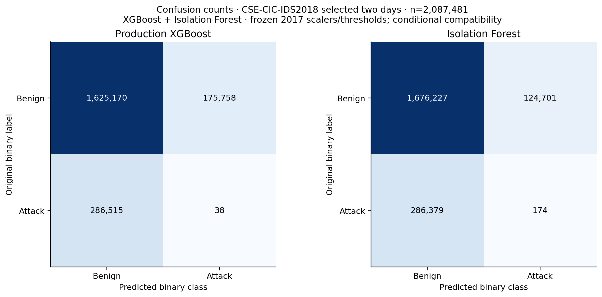
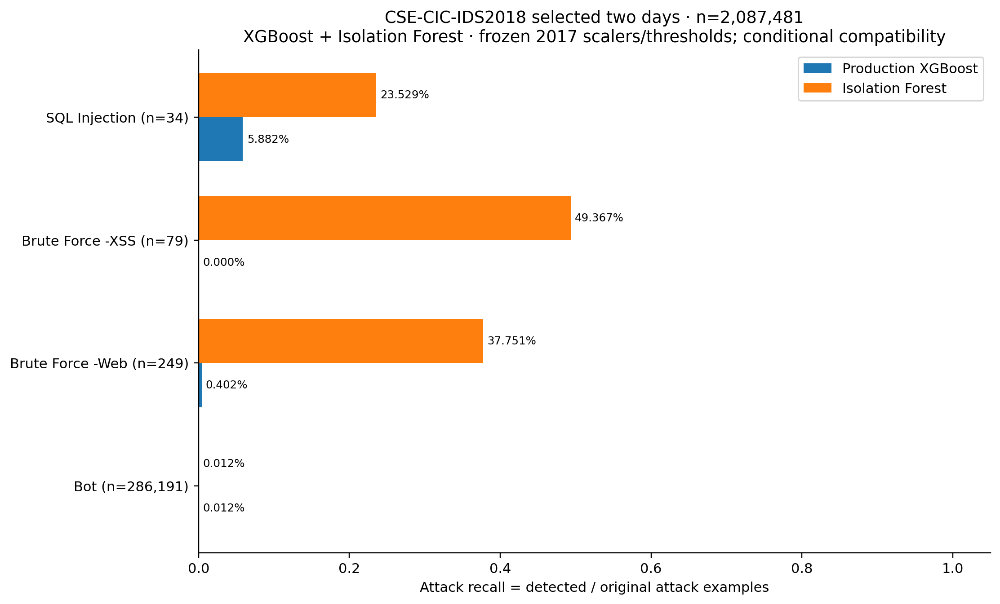
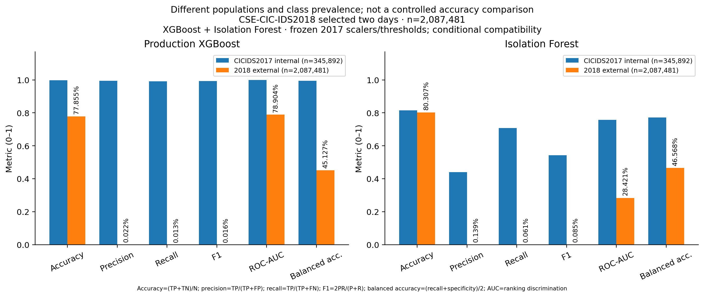
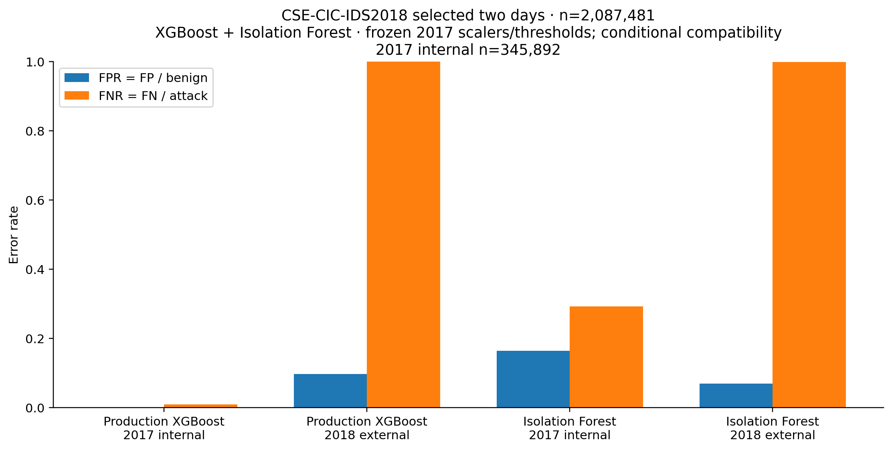
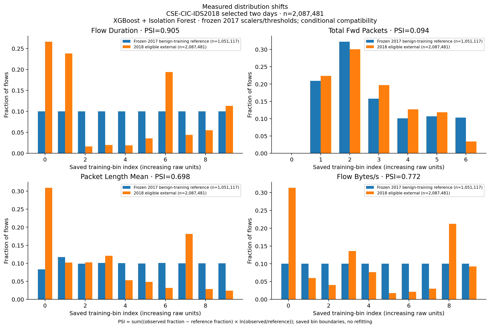

# Issue 4 — frozen external dataset validation

This report records an executed two-day CSE-CIC-IDS2018 evaluation of the unchanged CICIDS2017-trained detectors. It is not full-dataset evaluation, independent-site validation, retraining, calibration or threshold optimization. Feature compatibility is **CONDITIONALLY_COMPATIBLE**; all eleven published measurements map, but generating extractor builds are unrecorded. Read FEATURE_COMPATIBILITY.md before interpreting metrics.

The result is negative: at their unchanged thresholds both models miss nearly all attacks in the selected external population. No threshold was adjusted to conceal this. Application verification status is separate from model performance.

## Protocol and data provenance

The prediction-independent selection policy was recorded in PROTOCOL.md before external inference: the earlier documented web-attack day (22 February) and the bot day (2 March), targeting the previously weak categories. Both contain benign traffic. All objectively valid rows from both files were evaluated. No performance-based sample selection, duplicate removal, outlier removal or false-negative removal occurred. No PCAPs or full dataset collection were downloaded.

Official source: [UNB CSE-CIC-IDS2018](https://www.unb.ca/cic/datasets/ids-2018.html), [AWS registry](https://registry.opendata.aws/cse-cic-ids2018/), anonymous bucket cse-cic-ids2018, region ca-central-1. Source inventory was inspected first. The two files total 735,004,575 bytes; full original CSVs remain in ignored scratch storage. Official HTTPS origin establishes retrieval provenance; multipart ETags are not cryptographic signatures. Locally measured SHA-256 pins exact retrieved bytes.

| Source file | Bytes | SHA-256 |
|---|---:|---|
| Thursday-22-02-2018_TrafficForML_CICFlowMeter.csv | 382636202 | `da33c927018274f9d49b145baa00e4ce0526c25b3b890b34c489e247b5e24544` |
| Friday-02-03-2018_TrafficForML_CICFlowMeter.csv | 352368373 | `d96f38e7496aba83475031e6fb8c6fdf1abf6aa1b71325a917798f3c7de93de1` |

## Models, compatibility and processing

Both exact production bundles were verified before inference and after evaluation. IDs, frozen thresholds and post-run hashes are in frozen-model-verification.json. The existing fitted StandardScaler transforms raw mapped features once; labels are kept in separate arrays and never passed to a model. The evaluation process actively forbids IsolationForest, StandardScaler and XGBClassifier fitting. External application uploads reject threshold overrides. Historical Issue 3 files were not modified.

| Detector | Actual ID | Original threshold | Artifact SHA-256 after evaluation |
|---|---|---:|---|
| supervised | xgb-bin-12ad91fa39 | 0.4343418846451664 | `ee4bc46fee3d1957bd080246c84bf6dedee246b25d29c1ecd6dfaf63d2100e3f` |
| baseline | iforest-65dd0b57a2b1a2020a0b | 0 | `8602d9e6f57d347a10ebbca7290ad2bc75892f9c7f8b29dcc97c2fea20035c0d` |

The versioned adapter, explicit mapping, source headers and numerical type/units checks are in ml/external_dataset_adapter.py, compatibility.json, feature-preflight.json and FEATURE_COMPATIBILITY.md. Source aliases match historical official CICFlowMeter code. Duration is microseconds; packet lengths/totals are payload bytes; packet counts are counts; rates are per second. Published rounding is preserved. The exact originating binary for either dataset is unavailable, so extractor-specific flow construction/packet statistics remain a limitation, not an asserted equivalence.

Chunks: 25,000 source rows; total executed evaluation/audit time: 629.949 seconds. All selected source bytes were SHA-256 checked before and after processing. The protocol assessed approximately 8.3 GB RAM, 12 logical CPUs and 49.6 GB free disk at start. SQLite and compressed ledgers limit memory growth; exact score arrays support ROC-AUC/AP without score binning. environment.json records the actual runtime versions.

## Data quality and exclusions

Only missing/nonnumeric/NaN/infinite/negative required measurements, transformed input overflow and explicitly unknown ground-truth labels are ineligible. Optional-field missingness is not an exclusion. Finite zero-duration rows and all duplicates remain eligible. Repeated header rows are invalid source records, counted rather than silently skipped. Reason counts can overlap; excluded-record totals are unions. Original labels are retained, including original spelling. Unknown labels are never guessed.

| Day | Source records | Eligible | Excluded | Duplicate copies retained | Zero duration (source) |
|---|---:|---:|---:|---:|---:|
| Thursday-22-02-2018_TrafficForML_CICFlowMeter.csv | 1048575 | 1042956 | 5619 | 3278 | 5610 |
| Friday-02-03-2018_TrafficForML_CICFlowMeter.csv | 1048575 | 1044525 | 4050 | 5459 | 4050 |

Detailed source/eligible/excluded class distributions and exclusion counts per label/reason are in data-quality.json. A complete compressed ledger with source filename, zero-based row index, original label and all exclusion reasons is retained outside Git; exclusion-ledger-summary.json pins its location and SHA-256. Duplicate auditing uses SHA-256 over all original parsed column tokens, with original records unchanged; it assumes no cryptographic collision. Conflicting valid feature vectors are counted in overlap.json and retained.

## Actual external metrics

Both models use the same eligible external population and their original decision thresholds. ROC-AUC uses attack-oriented scores (negated decision margin for Isolation Forest); PR-AUC is exact average precision. Unsupported single-class metrics are null. Model scores are uncalibrated and are not accuracy; final triage risk is a separate review priority.

| Metric | Production XGBoost | Isolation Forest |
|---|---:|---:|
| samples | 2087481 | 2087481 |
| benign | 1800928 | 1800928 |
| attack | 286553 | 286553 |
| accuracy | 0.77854984 | 0.80307366 |
| precision | 0.00021616 | 0.00139339 |
| recall | 0.00013261 | 0.00060722 |
| f1 | 0.00016438 | 0.00084583 |
| macro_f1 | 0.43782509 | 0.44580935 |
| roc_auc | 0.78903582 | 0.28420515 |
| average_precision | 0.28117771 | 0.11615608 |
| specificity | 0.90240698 | 0.93075737 |
| false_positive_rate | 0.09759302 | 0.06924263 |
| false_negative_rate | 0.99986739 | 0.99939278 |
| balanced_accuracy | 0.45126980 | 0.46568229 |

| Detector | TN | FP | FN | TP |
|---|---:|---:|---:|---:|
| supervised | 1625170 | 175758 | 286515 | 38 |
| baseline | 1676227 | 124701 | 286379 | 174 |



## Per-day and attack-label performance

| Detector / day | Samples | Accuracy | Attack recall | FPR | Balanced accuracy |
|---|---:|---:|---:|---:|---:|
| supervised / Thursday-22-02-2018_TrafficForML_CICFlowMeter.csv | 1042956 | 0.88683319 | 0.00828729 | 0.11286177 | 0.44771276 |
| supervised / Friday-02-03-2018_TrafficForML_CICFlowMeter.csv | 1044525 | 0.67042914 | 0.00012230 | 0.07660081 | 0.46176074 |
| baseline / Thursday-22-02-2018_TrafficForML_CICFlowMeter.csv | 1042956 | 0.93088683 | 0.38950276 | 0.06892520 | 0.66028878 |
| baseline / Friday-02-03-2018_TrafficForML_CICFlowMeter.csv | 1044525 | 0.67545248 | 0.00011531 | 0.06967906 | 0.46521812 |

| Original attack label | Samples | XGBoost detected / missed | Recall | IF detected / missed | Recall |
|---|---:|---|---:|---|---:|
| Bot | 286191 | 35 / 286156 | 0.00012230 | 33 / 286158 | 0.00011531 |
| Brute Force -Web | 249 | 1 / 248 | 0.00401606 | 94 / 155 | 0.37751004 |
| Brute Force -XSS | 79 | 0 / 79 | 0.00000000 | 39 / 40 | 0.49367089 |
| SQL Injection | 34 | 2 / 32 | 0.05882353 | 8 / 26 | 0.23529412 |

The original per-label counts, correct/incorrect decisions and benign false-positive rate are in evaluation.json. These are binary attack-detection results by original family, not predictions of a multiclass model.



## Internal vs external comparison

The internal 2017 partition and targeted external two-day population have different class mixtures, prevalence and collection conditions. Their difference is descriptive, not a controlled causal estimate. Neither dataset name proves statistical independence.

| Detector / metric | CICIDS2017 internal (n=345892) | Selected CSE-CIC-IDS2018 external |
|---|---:|---:|
| Production XGBoost / accuracy | 0.99768136 | 0.77854984 |
| Production XGBoost / precision | 0.99393159 | 0.00021616 |
| Production XGBoost / recall | 0.99111864 | 0.00013261 |
| Production XGBoost / f1 | 0.99252312 | 0.00016438 |
| Production XGBoost / roc_auc | 0.99992256 | 0.78903582 |
| Production XGBoost / false_positive_rate | 0.00111231 | 0.09759302 |
| Isolation Forest / accuracy | 0.81545974 | 0.80307366 |
| Isolation Forest / precision | 0.44123350 | 0.00139339 |
| Isolation Forest / recall | 0.70758546 | 0.00060722 |
| Isolation Forest / f1 | 0.54353283 | 0.00084583 |
| Isolation Forest / roc_auc | 0.75679037 | 0.28420515 |
| Isolation Forest / false_positive_rate | 0.16471128 | 0.06924263 |





## Drift and representation overlap

PSI is computed by accumulating all eligible external values in saved training-only reference bins, not by averaging chunk PSI or refitting reference bins. It measures distribution change, not attack confidence. Supervised inference has no separately required drift calibration; where no supervised reference is packaged, the saved baseline benign-training reference is explicitly used. Contrast against a benign-only reference is confounded by external attack prevalence.

| Feature | XGBoost reference PSI | IF reference PSI |
|---|---:|---:|
| Flow Duration | 0.904561 | 0.904561 |
| Total Fwd Packets | 0.094240 | 0.094240 |
| Total Length of Fwd Packets | 0.858532 | 0.858532 |
| Fwd Packet Length Max | 0.659209 | 0.659209 |
| Fwd Packet Length Min | 0.506810 | 0.506810 |
| Fwd Packet Length Mean | 0.555507 | 0.555507 |
| Bwd Packet Length Max | 1.109053 | 1.109053 |
| Bwd Packet Length Min | 0.355741 | 0.355741 |
| Flow Bytes/s | 0.772473 | 0.772473 |
| Flow Packets/s | 0.915422 | 0.915422 |
| Packet Length Mean | 0.698442 | 0.698442 |



Measured overlap against all approved eligible 2017 raw vectors and each model-specific float32 representation:

```json
{
  "status": "AUDITED",
  "matching_rows": {
    "raw_rows_matching_any_2017_partition": 251041,
    "supervised_rows_matching_any_2017_partition": 367354,
    "supervised_rows_matching_2017_training": 275354,
    "baseline_rows_matching_any_2017_partition": 368140,
    "baseline_rows_matching_2017_training": 275554
  },
  "rows_removed": 0,
  "source": ".test-artifacts\\issue3\\513da53c9db64dd9a545e980271dad37.sqlite",
  "external_conflicting_feature_groups_retained": 627
}
```

The read-only Issue 3 audit was checked against the approved dataset identity and raw unique-vector count. Matching rows were not filtered. Simple/repeated flows and quantization can produce aliases; matches alone do not prove copied captures, and absent exact matches would not exclude related sessions. If no reference audit is supplied, the tool explicitly reports NOT_RUN.

Measured findings are the PSI histograms, class distributions, exclusions, overlaps and detection errors above. Plausible explanations include network/environment differences, attack implementations, collection policies, rounded rates and CICFlowMeter revisions. Those are hypotheses; this experiment does not establish their causal contributions.

feature-quality.json additionally records full-source missing, explicit NaN, nonnumeric, infinity, negative and zero counts for every required feature, together with eligible-population means/min/max and the saved 2017 holdout comparison. These are descriptive statistics, not new model normalization. Exact raw-vector overlap is parser- and precision-dependent; the separate model-specific float32 audit captures the representation actually consumed by the trees.

## Real application demonstration

Run 817fc3c335cf496fa7ff25a55b4ee01a: actual HTTP backend 5049, owned MongoDB cyber_triage_test_817fc3c335cf496fa7ff25a55b4ee01a on dedicated port 27018; React proxy 5219. The 60-row demo consists of the first 10 eligible source rows per original label per day, selected before predictions. Raw source aliases/measurements are unchanged and labels are retained separately in the ignored source manifest. Input SHA-256 before/after: ea02d2e08195e16fa5d88e2bcd61f59ac85e9d8057a8075cc39ddf45e47921e8. This class-stratified demonstration is not representative external population accuracy.

| Detector / saved case | Flows | Attack decisions | Normal decisions | Demo accuracy | Demo recall | HTTP seconds |
|---|---:|---:|---:|---:|---:|---:|
| supervised / CASE-02C1EFF54BC5 | 60 | 3 | 57 | 0.350000 | 0.050000 | 1.888695 |
| baseline / CASE-3EACD8C7674C | 60 | 19 | 41 | 0.383333 | 0.275000 | 0.155528 |

Actual API predictions agree with direct frozen inference; scores match within 1e-12 and all eleven source measurements survive MongoDB exactly. Model IDs and thresholds persist in artifacts, case evidence and history. Missing features and external threshold overrides return structured 400 errors. Public API evidence omits raw feature records; full source/prediction evidence and PDFs are retained outside Git. Summary JSON pins PDF paths/checksums. Both 20-page PDFs were rendered and visually inspected, including source/compatibility sections; render verification is in the demo directory.

Live browser verification: **BLOCKED_SETTING**. Observation: After the user confirmed enabled, both browser-tab creation and a freshly reset browser inventory still returned Local browser use is disabled in Work settings.. Real screenshots captured: False. No mock dashboard is counted as UI integration. Service tests/build and HTTP/database/PDF checks are distinct from a live click-through. If browser access remains blocked, overall application acceptance is PARTIAL even though external metric evaluation executed.

## Regression and reproducibility

Full native/MongoDB regression: 367 passed, 46 skipped, 0 failures, 0 errors. Exact output is in regression-final.txt/XML. Original no-training skip reasons remain explicit. Frontend test/build output is in frontend.txt and check-all.txt. The actual CSV chunk-invariance regression compares exact predictions and scores over different chunk sizes. Source mapping, bad names/units, duplicate headers, missing/nonnumeric/infinite/NaN/negative measurements, unknown labels, zero durations, frozen thresholds, metrics and selector paths are covered.

alignment-verification.json independently reconstructs all source row identities and original labels, checks every saved-score threshold decision, recomputes all metrics, and compares a deterministic source-chunk sample with fresh direct inference. Source-row and prediction archives remain outside Git, pinned by SHA-256. execution-note.json records the interrupted IO-bound attempt and tested bulk-join optimization without changing population, model or thresholds.

Commands and setup: docs/external_validation.md. Full experiment commands:

```powershell
rtk proxy .venv/Scripts/python.exe -m scripts.acquire_external_dataset
rtk proxy .venv/Scripts/python.exe -m scripts.evaluate_external_network --chunk-size 25000 --overlap-db .test-artifacts/issue3/513da53c9db64dd9a545e980271dad37.sqlite
rtk proxy .venv/Scripts/python.exe -m scripts.verify_issue4 --serve
rtk proxy .venv/Scripts/python.exe -m scripts.external_feature_quality
rtk proxy .venv/Scripts/python.exe -m scripts.verify_external_alignment
rtk proxy .venv/Scripts/python.exe -m scripts.render_external_reports
rtk proxy .venv/Scripts/python.exe -m scripts.plot_external_validation
rtk proxy .venv/Scripts/python.exe -m scripts.report_external_validation
rtk proxy .venv/Scripts/python.exe -m pytest --no-training --run-integration -q
rtk proxy .venv/Scripts/python.exe scripts/check.py --all --no-training
```

## Known limits and review status

Chunk-size invariance applies to frozen predictions, scores and detection metrics. The unchanged baseline triage policy remains upload-batch-relative; no batch-relative risk scores are used for this external evaluation.
This is a genuine external benchmark subset, not arbitrary real-world deployment proof. Both CIC datasets are old and related by research group/extractor family. Only web-attack and bot days were selected; other attack families/days are untested. Objective validity filtering changes prevalence, duplicates remain, and per-family counts may be small. Generating-binary provenance and possible label/collection artifacts limit compatibility certainty. Poor recall and false alarms must not be hidden behind overall accuracy. No model was retrained, retuned or replaced after observing these results.

Feature branch: codex/issue-4-external-validation from published Issue 3 main 365e5568fa97c573307da02f10b84ae49040674d. Main must remain unchanged pending review. Exact final commit, PR and CI verification are given in the final task response. No private evidence, raw CSV records, dataset binaries or complete source-row ledgers are intended for Git.

## Interpretation notes

The overflow guard separately inspects a saved-scaler transform, but never passes that transformed matrix back as raw inference input. Each model receives the mapped original measurements and uses its own frozen preprocessing; direct-inference equality checks rule out the earlier double-scaling path.

Both external balanced accuracies are below 0.5 and attack recall is extremely low. Aggregate accuracy must not be presented as acceptable external detection. XGBoost score-ranking ROC-AUC differs from thresholded recall; this observation does not justify choosing a new threshold from external labels.

Both official CSVs have 1,048,575 source records. Evaluating every row in these files does not establish completeness of the underlying daily packet captures.

## Issue 4B final verification — 30 October 2026 (Asia/Calcutta)

**Overall completion remains PARTIAL. Browser acceptance is BLOCKED.** The approved browser inventory still returned Local browser use is disabled in Work settings. No new browser screenshots were captured. The runtime requires all UI automation through cua_repl; local Playwright is not an authorized bypass. The project currently uses Node service tests/Vite build rather than a browser-test framework.

The existing backend and owned MongoDB environment were reused. React was restarted with --host 127.0.0.1 --port 5219 after its default localhost binding collided with an existing listener. Both services now respond successfully through IPv4, including frontend-proxy case/history reads. These HTTP checks do not establish real React upload/refresh/download acceptance.

Fresh regression: **367 passed, 46 skipped, zero failures/errors**; **17 frontend tests passed**, production build passed, Ruff passed. The first run had one 1.5-second dedicated MongoDB setup timeout (366 passed/46 skipped/1 error); its original log is retained. The unchanged full suite was rerun serially and passed without assertion or timeout changes. See issue-4b/regression-final.txt/XML and frontend.txt.

Saved-case recheck: XGBoost case CASE-02C1EFF54BC5 retains 60 flows, 3 attack and 57 benign decisions; IF case CASE-3EACD8C7674C retains 60 flows, 19 anomaly/attack and 41 normal/benign decisions. Direct MongoDB fields exactly match saved API predictions, scores, thresholds and priorities. Both freshly downloaded API PDFs have 20 pages and the expected case/model/dataset/compatibility text. They were not generated through a browser UI, so frontend report download remains unverified. Evidence: issue-4b/saved-case-recheck.json. Original cases were not re-ingested or replaced.

Evaluation JSON, both network model artifacts and the EMBER2024 model have identical before/after SHA-256 hashes. No full external reevaluation, retraining, recalibration, retuning or Issue 5 implementation occurred. XGBoost TP=38/FN=286515 and IF TP=174 remain unchanged.

Exact manual A-F steps and six required genuine screenshots are in [the manual guide](issue-4b/MANUAL_BROWSER_VERIFICATION.md). Missing-model checks use an isolated configuration, never renamed/deleted real weights. Until actual browser evidence is reviewed, leave PR #24 draft and main unchanged. Vercel deployment is out of scope per the owner. The planning-only next-issue handoff is in docs/issue-5-handoff.md.
